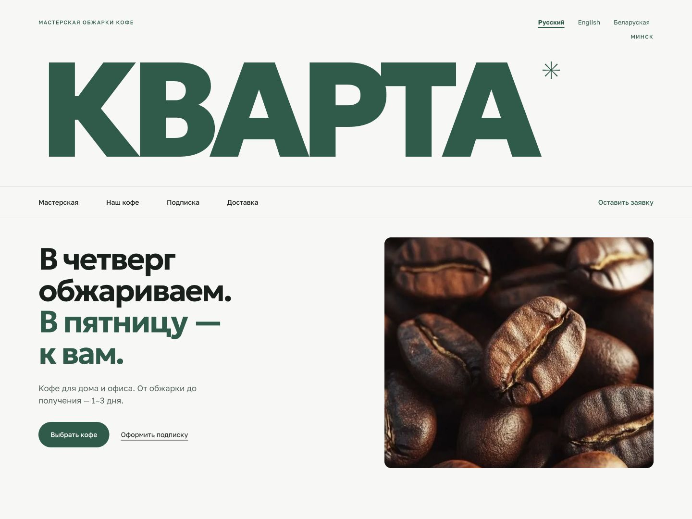

# Kvarta Coffee

A website concept for a small coffee roastery in Minsk. Kvarta combines an editorial layout, a coffee catalog and monthly subscriptions with a working callback inquiry form.

[Live demo](https://kvarta-coffee-five.vercel.app) · [Русский](https://kvarta-coffee-five.vercel.app/ru) · [English](https://kvarta-coffee-five.vercel.app/en) · [Беларуская](https://kvarta-coffee-five.vercel.app/be)



## Features

- Russian, English and Belarusian versions with language switching that preserves form details and selected coffees.
- Coffee profiles, starting recipes, a workshop gallery, subscription details, delivery and pickup information.
- One-time orders with multiple coffees and quantities, or a monthly subscription inquiry.
- Shared browser/server validation, clear submission feedback and retry without losing entered details.
- PostgreSQL storage with transactional protection against duplicate inquiries from the same phone within ten minutes.
- First-touch campaign tracking: source, medium, campaign, ad content, search term, landing page and submission page.
- Responsive layouts, keyboard-accessible dialogs and gallery, localized search metadata and social previews.

## Stack

Next.js 16, React 19, TypeScript, CSS Modules, PostgreSQL and Zod. Fonts are served locally. The deployed demo uses Vercel and Neon.

## Run locally

Requires Node.js 24+, npm and PostgreSQL command-line tools (`initdb`, `pg_ctl`, `psql`) on `PATH`.

```sh
npm ci
npm run db:local:start
npm run dev
```

Open the URL printed by Next.js. The database helper creates separate development and test databases, applies migrations and creates local environment files when absent. Existing configuration and data are preserved. PostgreSQL runs on loopback port `55439`; its files stay in the ignored `.local/postgres` directory.

```sh
npm run db:local:stop
```

To use an existing PostgreSQL server, copy `.env.example` to `.env.local`, fill in the connection values and apply the migrations:

```sh
npm run db:migrate
```

## Configuration and deployment

| Variable | Purpose |
| --- | --- |
| `SITE_URL` | Public site origin used in canonical URLs and social metadata. |
| `LEAD_ALLOWED_ORIGINS` | Exact comma-separated browser origins allowed to submit inquiries; required in production. |
| `DATABASE_URL` | Runtime PostgreSQL connection with `SELECT` and `INSERT` access to `leads`. |
| `MIGRATION_DATABASE_URL` | Owner connection used only by the explicit migration command. |
| `TEST_DATABASE_URL` | Separate disposable database whose name ends in `_test`. |

Apply the SQL migrations before releasing code that uses them. Set the production variables on the host, then build and start:

```sh
npm run build
npm start
```

The inquiry endpoint is `POST /api/lead`. It stores the contact details, inquiry type, selected products and quantities, and sanitized campaign context. Phone input is normalized to `+375` followed by nine national digits. Comments allow up to 1,000 characters. No cart or online payment is involved; the order is confirmed by phone.

## Checks

```sh
npm test
npm run test:integration
npm run lint
npm run typecheck
npm run format:check
npm run build
```

Integration tests use only the separate disposable test database. For a local production-build preview backed by that database, run `npm run preview:localization` after building. It opens `http://127.0.0.1:3001`.

## Demo content

Kvarta is a fictional brand. Coffee varieties, processing methods, growing altitudes and recipes are illustrative product content. Package and workshop images were generated for the concept; the bean and crema photographs were supplied by the project author. Geologica and Golos Text font licenses are included in `public/fonts/licenses`.
